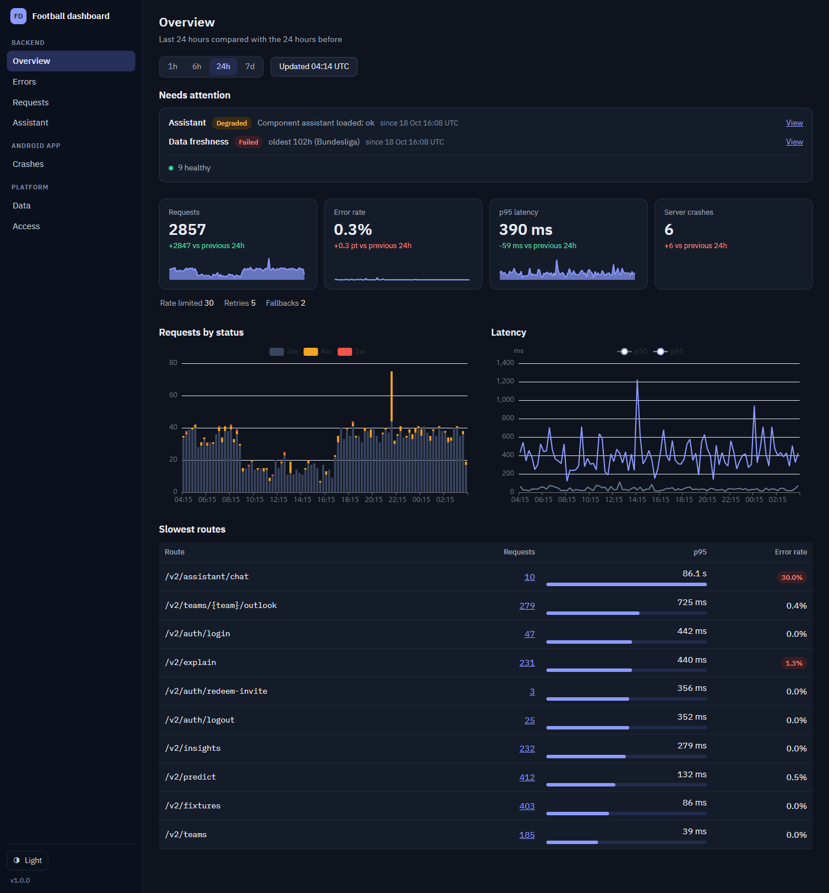
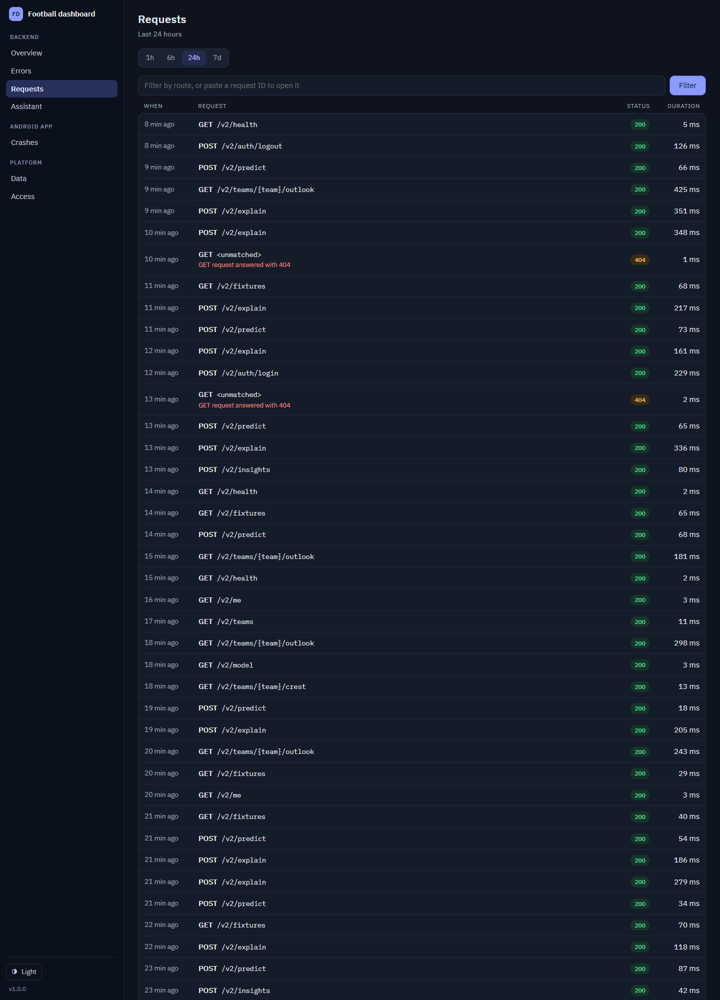
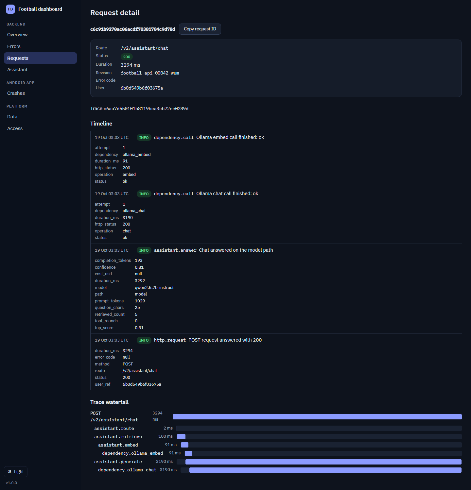
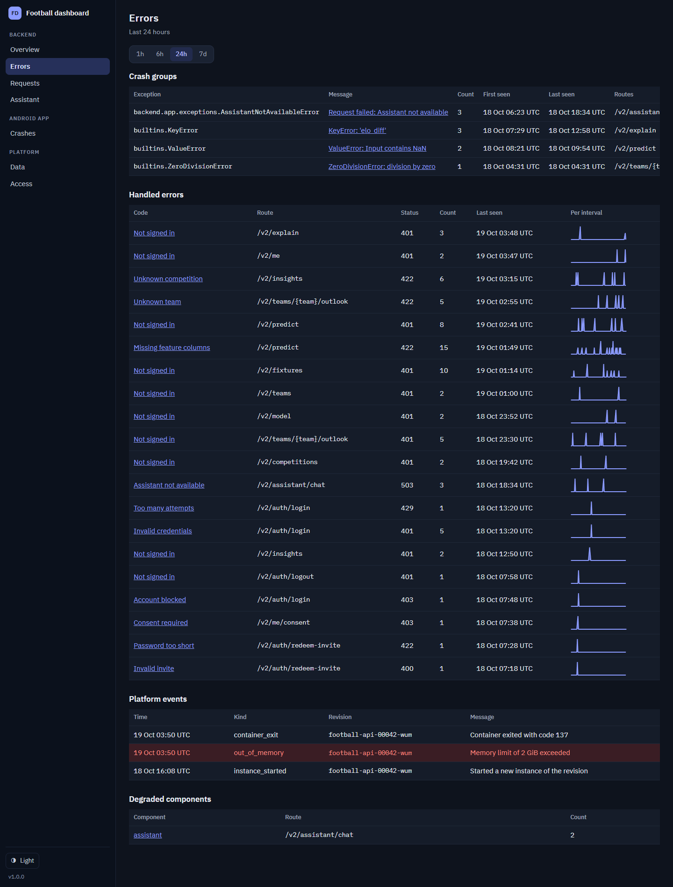
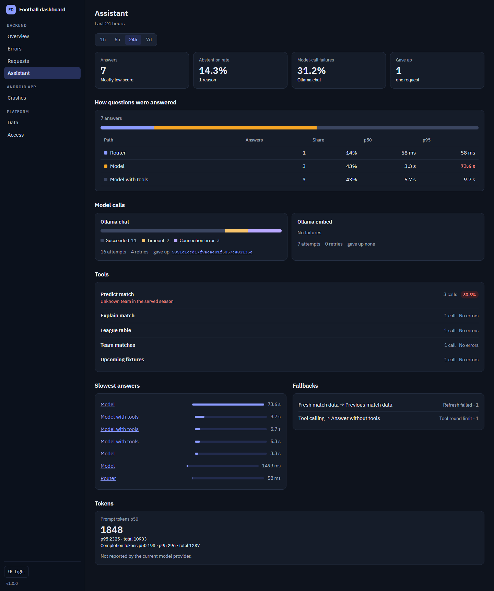
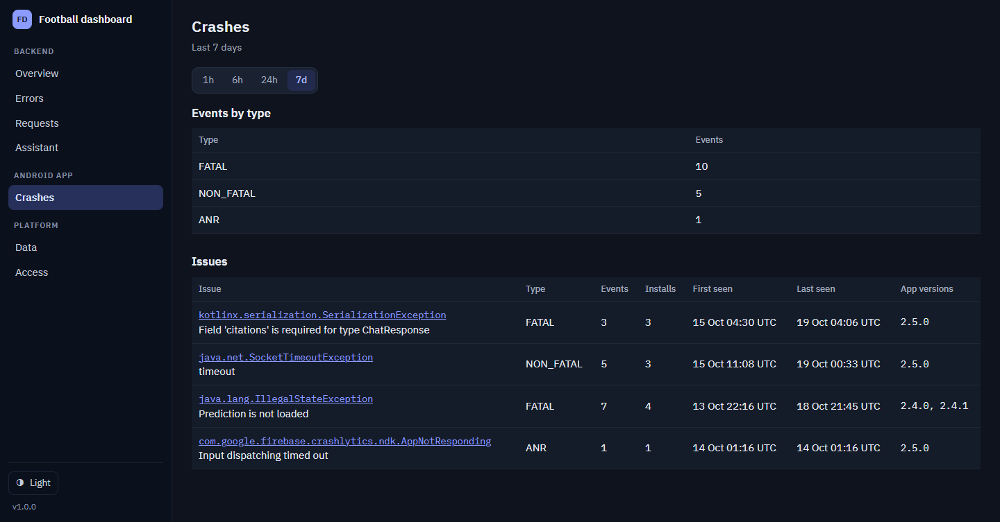
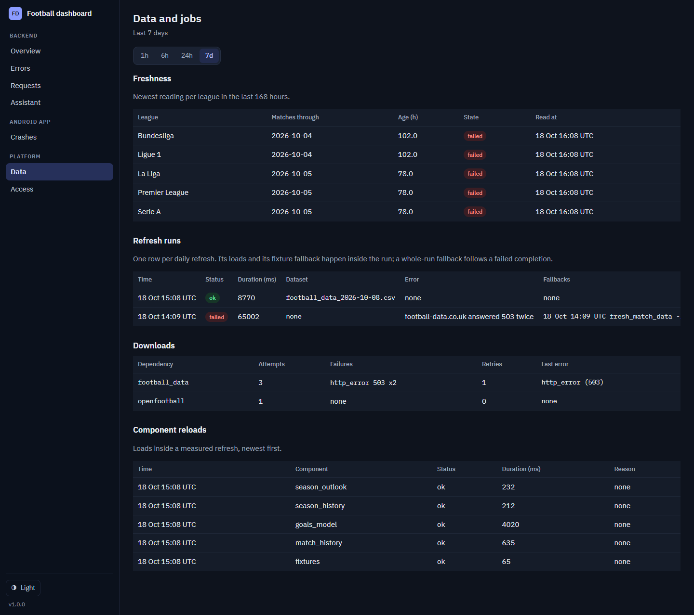
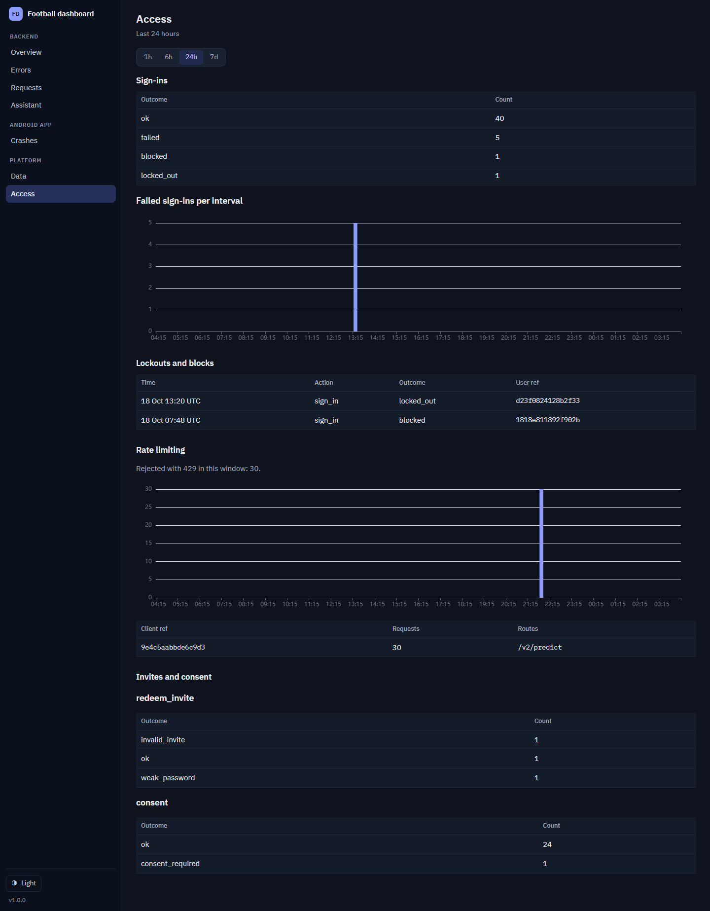
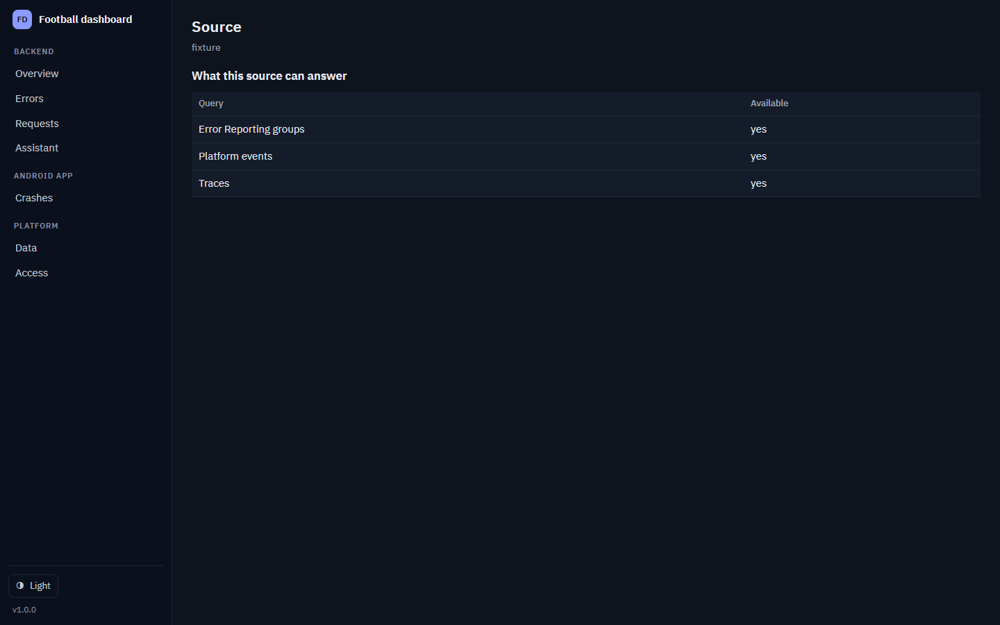
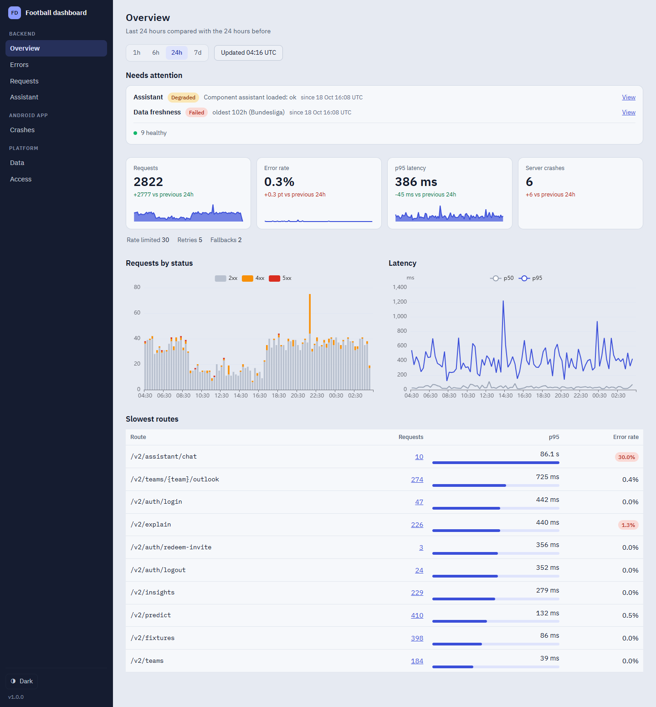

# Dashboard screenshots

Screenshots of every page of the Football Dashboard console, for a walkthrough of
someone who has never seen it.

Every image was taken from the `fixture` source — the sample day of telemetry that
ships with the repo — at 1440 px wide, in the default (dark) theme, with the page
scrolled to the top. That means anyone can reproduce them locally with no Google
Cloud account:

```bash
uv sync --extra dev
uv run uvicorn app.main:app
```

## What the console is for

The Football Intelligence backend answers questions about football matches and
serves a few Android app calls. This console is a **read-only window onto that
backend's telemetry**: what it serves, how fast, what fails, and how the assistant
arrived at its answers. It reads what the backend already sends to Google Cloud,
and apart from the opt-in invite page it writes nothing.

The sidebar is the way around, and it mirrors who runs what:

| Sidebar section | Pages | Covers |
| --- | --- | --- |
| Backend | Overview, Errors, Requests, Assistant | the HTTP API and the assistant behind it |
| Android app | Crashes | the app's crashes, non-fatals and ANRs |
| Platform | Data, Access | the daily data refresh, and who signs in |

A page that is switched off in configuration is left out of the sidebar
altogether, so the console never shows a link that leads to nothing. Invites, for
example, only appears when that feature is enabled.

## The frame around every page

Four things behave the same way everywhere, so they are worth knowing up front:

- **The time window.** `1h 6h 24h 7d` picks the period every number on the page is
  calculated over. Pages that look at infrastructure rather than live traffic
  default to 7 days; the rest default to 24 hours.
- **Numbers you can click.** Cards and rows are usually links into the filtered
  Requests list, so a surprise on a summary page is one click from the raw rows.
- **Times are UTC**, and a window's end is exclusive — a request at the boundary
  belongs to the next window, never to both.
- **Wide tables scroll sideways inside their own box** rather than pushing the
  whole page sideways. A clipped right-hand column in a screenshot below is that
  behaviour, not a missing column.

The footer holds the theme toggle and the version. The console ships with a dark
theme (the default) and a light one; both are shown at the end.

---

## 1. Overview — is anything wrong right now?



The page to open first. **Needs attention** lists only the components that are
not healthy, what its last read said and when — a healthy console says so in one
line and stays quiet. The four cards underneath are the headline numbers
(requests, error rate, p95 latency, and server crashes) each compared against the
window immediately before, so you can tell "busy" from "getting worse".

Below that, requests by status and latency over the window, then the slowest
routes. The sparklines are the same shape you meet on the other pages: one bar per
time bucket, so a spike has a time of day rather than just a total.

## 2. Requests — what the backend actually served



One row per request: when, the route, the status and how long it took. Failed
requests carry their error code and message on the row rather than hiding in a
log.

The box at the top filters the list by route, status, event, component, or a raw
request ID — which is what the small numbers elsewhere link into. Rows are links
to the request's own page.

## 3. Request detail — what happened inside one request



The facts on the request (route, status, duration, revision, error code, user),
then its **trace** if it has one.

The timeline lists the events the backend emitted while handling it, with the
fields each event carried. The waterfall at the bottom puts those same spans on a
time axis, which is how you see that a 3.3-second answer was 3.2 seconds of one
model call rather than slow retrieval.

## 4. Errors — what failed



Four questions, top to bottom:

- **Crash groups** — unhandled server exceptions, grouped by exception type, with
  how often each happened, when it was first and last seen, and which routes hit
  it.
- **Handled errors** — errors the backend caught and turned into a status code
  (401s, 422s and so on), grouped by error code and route, with a per-interval
  sparkline behind each row, so a burst is visible as a burst.
- **Platform events** — what Cloud Run did to the service: out-of-memory kills and
  container exits, and instances starting. An out-of-memory row is the one to
  look for first when latency spikes.
- **Degraded components** — a component that is reachable but not working
  properly, and how many times it said so.

## 5. Assistant — how the assistant answered



The console shows how the assistant answered, never what was asked or answered.
**How questions were answered** splits the answers by path — the router answered
directly, the model answered, or the model used tools — with latency for each
path, so a slow path is obvious next to a fast one.

**Model calls** and **Tools** show the underlying calls and whether any of them
failed or timed out, including links to the requests where they did. **Slowest
answers** and **Fallbacks** show the individual slow ones and where the assistant
had to fall back to a different strategy. **Tokens** covers prompt and completion
sizes and cost — and says plainly when the model provider does not report a
figure, rather than showing a zero.

## 6. Crashes — the Android app



Read from the Crashlytics export, and only shown when that export is configured.
**Events by type** counts fatal, non-fatal and ANR events; **Issues** groups them
into the distinct problems, each with occurrences, affected installs, first and
last seen, and the app versions it appeared in. A crash that only affects one app
version is usually a client bug with a known fix.

## 7. Data — is the data fresh?



Behind every prediction is a daily refresh of football data. **Freshness** is the
answer to "can I trust last night's numbers": one row per competition, showing how
far behind it is and whether the last read worked. **Refresh runs** is the daily
job itself, with duration, dataset, any error, and any fallback it used.
**Downloads** counts the upstream site's failures and retries, and **Component
reloads** lists the individual pieces loaded inside a measured run.

## 8. Access — who signs in



Sign-in outcomes over the window, then failed sign-ins per interval. **Lockouts
and blocks** shows the accounts and clients that were stopped, and **Rate
limiting** shows which client was rejected and which route it was hammering —
usually enough to tell an attack from a broken app build retrying in a loop.
Invite redemptions and consent decisions follow.

## 9. Source — where the numbers come from



Reached from the sidebar footer, not the main navigation. It names the telemetry
source the console is reading, and, honestly, what that source can and cannot
answer — Cloud Trace, Error Reporting and platform events are three separate
reads, and a source may support some and not others. When the source is a local
log file it also reports how the last read of that file went. This is the page to
check before believing a blank section is good news.

## 10. The light theme



Same page, same data, light theme. The choice is remembered per browser, and
every chart follows it.

---

## Taking these again

The images were produced by running the console against the fixture source at
1440 px wide with the dark theme and the page scrolled to the top — for example in
a browser window resized to that width, using the browser's own screenshot
tooling. Lists longer than about 2000 px (the Requests table, for one) are cut off
in the image; the page continues past the bottom of the picture.

The Errors and Crashes pages are being redesigned (see
[`guide/D8-redesign.md`](../../guide/D8-redesign.md)); refresh those two images
once that work has landed.
